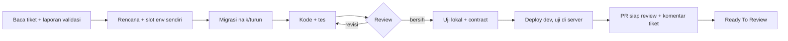

# Backend Agent Workflow

Tim agen AI yang mengerjakan tiket di proyek **Backend**: mengecek tiket, menulis migrasi database dan kode, menguji API, deploy ke server uji, membuat PR/MR, sampai menyiapkan rilis.

Bisa dipasang ke **Claude Code, Codex CLI, Gemini CLI, Cursor**, atau agent lain yang membaca `AGENTS.md`, untuk satu project atau semua project ([pilih agent](#pasang-5-menit)).

Bayangkan sebuah tim kecil: ada **mandor** (SPV) yang membagi tugas, **programmer** yang menulis kode, **reviewer** yang memeriksa, **QA** yang menguji, dan **petugas rilis** yang deploy dan membuat PR. Kamu cukup mengetik satu perintah; tim agen bekerja, lalu bertanya kepadamu hanya untuk keputusan penting.

> Status: **v1**, kerangka lengkap dan teruji dengan tes otomatis, **belum dicoba di tiket nyata**.
> Workflow saudara: [mobiledev-agent-workflow](https://github.com/roiskhoiron/mobiledev-agent-workflow) (aplikasi mobile) dan [sdd-agent-workflow](https://github.com/roiskhoiron/sdd-agent-workflow) (pembuat tiket).

## Daftar isi
1. [Apa bedanya dengan workflow Mobile?](#apa-bedanya-dengan-workflow-mobile)
2. [Yang perlu disiapkan](#yang-perlu-disiapkan) dan [syarat stack](#syarat-stack-spec-openapi-dari-kode)
3. [Pasang (5 menit)](#pasang-5-menit)
4. [Setup pertama per project](#setup-pertama-per-project), termasuk [memilih platform tiket](#platform-tiket-pilih-sekali)
5. [Lima perintah](#lima-perintah)
6. [Contoh sehari-hari](#contoh-sehari-hari)
7. [Yang tidak pernah dilakukan agen](#yang-tidak-pernah-dilakukan-agen)
8. [Istilah penting](#istilah-penting)
9. [Panduan lanjutan](#panduan-lanjutan)
10. [Isi repo dan merawat dokumen](#isi-repo)

## Apa bedanya dengan workflow Mobile?

| | Mobile | Backend (repo ini) |
|---|---|---|
| Tempat uji | HP, emulator, simulator | Layanan lokal + server dev/beta: request API, log, database uji |
| Bukti di laporan | Screenshot bertanda kotak merah | Request, response, potongan log, hasil query (rahasia otomatis disamarkan) |
| Langkah tambahan | — | **Migrasi database** naik dan turun, diuji bolak-balik |
| Posisi terhadap contract API | Pemakai | **Penyedia**: perubahan tidak boleh merusak aplikasi versi lama |
| Hasil kerja | Build ke Firebase/TestFlight | Deploy ke dev, beta, (production dengan izin) |
| Sumber daya yang dibagi | Device | Port + database uji (satu per tiket), server dev/beta (satu deploy pada satu waktu) |

## Yang perlu disiapkan

| Wajib | Untuk apa |
|---|---|
| [Claude Code](https://code.claude.com) + Orca (sama dengan workflow Mobile) | menjalankan tim agen |
| `git`, `jq`, `python3`, `bash` | skrip dan pagar keamanan |
| Docker | database uji sekali pakai per tiket |
| **Stack Backend yang bisa mengekspor spec OpenAPI 3.x dari kode** | syarat wajib, lihat [Syarat stack](#syarat-stack-spec-openapi-dari-kode) |
| `gh` (GitHub) atau `glab` (GitLab), sudah login | PR/MR |
| Satu **platform tiket**: GitHub Issues + Projects, GitLab issue board, atau Jira | tempat tiket dibaca, dikomentari, dan digeser statusnya ([pilihannya](#platform-tiket-pilih-sekali)) |

| Disarankan | Untuk apa |
|---|---|
| `schemathesis`, verifier Pact, `oasdiff` | menguji contract API dan mendeteksi perubahan yang merusak klien |
| Konektor **Atlassian** | hanya bila platform tiketnya Jira (GitHub/GitLab cukup `gh`/`glab`) |
| Konektor **Claude Docs** | bila laporan ingin di Claude Docs, bukan di repo |

Alat yang belum terpasang tidak membuat workflow gagal: test case terkait ditandai **Tertahan** dan agen memberi tahu.

## Syarat stack: spec OpenAPI dari kode

Bahasa dan framework bebas, asal project bisa **membangkitkan spec OpenAPI 3.0/3.1 dari kode** (anotasi Swagger atau generator bawaan framework) dengan satu perintah. Contoh: `@nestjs/swagger`, `springdoc-openapi`, FastAPI (bawaan), `drf-spectacular`, `swaggo/swag` v2, `dedoc/scramble`, `Swashbuckle`.

Kenapa wajib? Contract API ditulis lebih dulu (dari workflow pembuat tiket). Spec yang dibangkitkan dari kode adalah **bukti** bahwa kode benar-benar memenuhi contract itu, dan dicek otomatis:

```bash
bin/openapi-check.sh validate spec-kode.json                     # standar OpenAPI 3.x? (Swagger 2.0 ditolak)
bin/openapi-check.sh diff contract.yaml spec-kode.json --paths '^/orders'   # kode sesuai contract?
```

Ada beda → kode diperbaiki, bukan contract.

## Pasang (5 menit)

```bash
git clone https://github.com/roiskhoiron/Backend-Agent-Workflow.git
cd Backend-Agent-Workflow
./install.sh          # menu: pilih AI coding agent + cakupan (global / project)
bash tests/run.sh     # pastikan semua tes lulus (ALL PASS)
```

`./install.sh` tanpa argumen menanyakan dua hal:

**1. AI coding agent yang dipakai** (boleh lebih dari satu)

| Agent | Skill dipanggil dengan | Pagar keamanan | Mode `--tim` |
|---|---|---|---|
| Claude Code | `/develop-tiket` | aktif (hook) | ya, teammate paralel |
| Codex CLI | `$develop-tiket` atau `/skills` | aktif setelah kamu *trust* hook-nya | solo |
| Gemini CLI | sebut tugasnya, skill dipilih otomatis | aktif (hook) | solo |
| Cursor | `/develop-tiket` | aktif (hook) | solo |
| Agent lain (`AGENTS.md`: opencode, Copilot, Windsurf, …) | minta agent membaca skill-nya | **tidak ada hook**, hanya aturan | solo |

**2. Cakupan**

| Cakupan | Artinya | Cocok bila |
|---|---|---|
| `global` | berlaku di semua project di komputer ini | kamu sendiri yang memakai |
| `project` | hanya di satu folder project (`.claude/`, `.agents/`, `AGENTS.md`, …) | ingin mencoba dulu, atau tiap project beda agent |

Tanpa menu (mis. di skrip):
```bash
./install.sh --agent claude --scope global                              # sama dengan versi lama
./install.sh --agent codex,cursor --scope project --project ~/kode/api   # dua agent, satu project
```

- Aman dijalankan berulang; file pengaturan lama dicadangkan sekali sebagai `<file>.bak-backend-workflow`.
- **Sudah memasang workflow Mobile?** Nama perintahnya sama, jadi `install.sh` berhenti dan memberi tahu. Pakai `--force` bila memang ingin beralih ke Backend.
- Selain Claude Code, `--tim` dijalankan sebagai `--solo`: satu sesi memainkan peran Coder → Reviewer → QA → Release berurutan.

Detail: [docs/pasang.md](docs/pasang.md).

## Setup pertama per project

Cukup sekali. Sebagian besar ditanyakan agen sendiri saat pertama dipakai.

### Platform tiket: pilih sekali
Workflow ini **tidak memilihkan platform tiket**. Defaultnya kosong (*none*); di perintah pertama, agen berhenti dan **bertanya kepadamu** dulu, lalu mengingat jawabannya untuk project itu.

| Pilihan | Cocok bila | Butuh |
|---|---|---|
| **GitHub Issues + GitHub Projects** | repo di GitHub, belum punya board (saran bila bingung) | `gh` sudah login |
| **GitLab Issues + issue board** | repo di GitLab, belum punya board (saran bila bingung) | `glab` sudah login |
| **Jira** | tim sudah memakai Jira | konektor Atlassian di Claude |

Kode tiket selalu berbentuk `PREFIX-nomor` (mis. `API-123`). Di GitHub/GitLab, `API-123` berarti issue `#123`; prefix-nya kamu tentukan sekali. Kamu boleh juga mengetik `#123` atau link issue.

### Langkah lainnya
1. **Host production** (wajib, diisi kamu sendiri): tulis host database dan API production, satu per baris, ke `~/.agent-workflow/prod-hosts.txt`. Pagar keamanan memakai daftar ini untuk menolak akses agen ke production.
   ```text
   db.prod.contoh.com
   api.contoh.com
   ```
2. **Akun uji**: salin `templates/qa.env.example` ke root project sebagai `qa.env`, tambahkan `qa.env` ke `.gitignore` **lebih dulu**, lalu isi nilainya.
3. **Kolom/status board**: saat pertama menggeser tiket, agen menampilkan status yang ada di board-mu (kolom Status GitHub Projects, label GitLab, atau status Jira) dan memintamu memilih yang dipakai untuk Todo, In Progress, dan Ready To Review. Done tidak pernah: menutup tiket selalu tugas manusia.
4. **Memory project**: agen bertanya sekali lalu mengingat: platform tiket, branch produksi/integrasi, URL server dev/beta/live, perintah tes/migrasi/deploy/**ekspor spec OpenAPI**, engine database, lokasi spec OpenAPI, klien yang memakai API, dan siapa yang menjalankan migrasi production. Jawabannya juga diberikan sebagai blok `## Catatan agen` untuk kamu commit ke `CLAUDE.md` project.

## Lima perintah

Ketik di Claude Code, di dalam terminal Orca. Alurnya mengikuti papan kanban: **Todo → In Progress → Ready To Review → Done** (Done selalu oleh manusia).

| Perintah | Kapan dipakai | Hasilnya |
|---|---|---|
| `/validate-tiket KODE` | Tiket baru di Todo | Laporan layak/tidak + bukti, komentar tiket, tiket ke In Progress bila layak |
| `/develop-tiket KODE` | Tiket di In Progress | Migrasi + kode + tes, deploy ke dev (dan beta), PR/MR, tiket ke Ready To Review |
| `/rilis-tiket KODE` | QA sudah memberi feedback | Kembalikan ke Todo, deploy ke env lain, atau merge PR tiket (dengan izinmu) |
| `/branch-manager --rilis KODE` | Saatnya rilis versi | Laporan rilis, regresi di beta, PR rilis, tag setelah kamu merge |
| `/audit-issue "keluhan"` | Ada keluhan tapi belum jadi tiket | Laporan penelusuran + saran tiket, **tanpa mengubah apa pun** |

Flag yang sering dipakai:

| Flag | Arti |
|---|---|
| `--solo` | Satu agen mengerjakan semua (hemat, untuk tiket kecil) |
| `--tim` | Dibagi ke beberapa agen (tiket besar, ada migrasi, banyak endpoint) |
| `--batch` (default) | Beberapa tiket digabung: satu deploy dev, satu putaran uji |
| `--separate` | Tiap tiket jalan dan selesai sendiri |

Tanpa flag, agen memilih sendiri. Alur lengkap tiap perintah: [docs/alur-kerja.md](docs/alur-kerja.md).

Perintah di atas memanggil **skill internal** Backend yang tidak perlu kamu ketik: `/reproduce-request`, `/check-compat`, `/write-migration`, `/test-integration`, `/verify-provider`, `/deploy-service`, `/deploy-variant` ([docs/alat.md](docs/alat.md)).

## Contoh sehari-hari

```text
/validate-tiket API-1234                 # cek dulu: layak dikerjakan?
/develop-tiket API-1234                  # kerjakan sampai Ready To Review
/develop-tiket API-1240 API-1241 --tim   # dua tiket sekaligus, dibagi ke tim
/rilis-tiket API-1234                    # setelah QA memberi feedback
/branch-manager --rilis API-1400         # siapkan rilis versi
/audit-issue "checkout kadang error 500 sejak v2.3" --solo
```

Yang terjadi saat `/develop-tiket API-1234`, singkatnya:



Agen akan **berhenti dan bertanya** bila: deploy production, migrasi yang menghapus/mengubah data, perubahan yang merusak aplikasi versi lama, contract API tidak bisa dipenuhi, atau kredensial tidak ditemukan.

## Yang tidak pernah dilakukan agen

Dijaga oleh pagar keamanan (`hooks/guard.sh`) dan aturan tim:

- Menyentuh **database production** atau menjalankan migrasi dengan env production.
- Menulis data ke server production lewat HTTP (di live hanya membaca).
- Menghapus container/volume Docker milikmu (hanya database uji buatannya sendiri).
- Push ke repo utama (`upstream`), force-push branch utama, atau menimpa tag.
- Memindah tiket ke **Done** atau menutup issue, atau merge PR rilis. Agen juga tidak menulis `Closes #123` di PR, karena GitHub/GitLab akan menutup issue otomatis saat merge.
- Deploy production tanpa izinmu untuk deploy itu.
- Menulis password/token ke laporan, platform tiket, atau PR.

Catatan jujur: pagar hanya membaca **teks perintah**. Alamat production yang tersembunyi di `.env` tidak terlihat olehnya, jadi aturan tim tetap berlaku. Detail: [docs/pagar-keamanan.md](docs/pagar-keamanan.md).

## Istilah penting

| Istilah | Penjelasan sederhana |
|---|---|
| **SPV** | Agen "mandor": membaca tiket, membagi tugas, memutuskan tiket selesai |
| **Workspace domain** | Workspace Orca yang kamu buka untuk kerja kode. Root project hanya untuk audit, tanya, dan rilis |
| **Worktree tiket** | Salinan kerja repo khusus satu tiket, folder `<repo>-<nomor>` di sebelah checkout |
| **Slot env** | Jatah port + database uji untuk satu tiket, supaya agen yang bekerja paralel tidak bentrok |
| **Database uji** | Database sekali pakai di Docker, satu per tiket; satu-satunya database yang ditulis tes dan migrasi |
| **Contract** | Spec OpenAPI yang disepakati Backend dan aplikasi pemakainya |
| **Kompatibilitas klien** | Aplikasi mobile versi lama tidak bisa dipaksa update, jadi perubahan yang merusaknya dipecah tiga tahap: tambah baru → klien pindah → hapus lama |
| **Migrasi naik/turun** | Perubahan struktur database dan kebalikannya |
| **Laporan** | Default: file Markdown di branch `agent-docs` repo kamu; bisa juga Claude Docs |
| **`origin` / `upstream`** | `origin` = fork kita (agen boleh push branch); `upstream` = repo utama (hanya lewat PR/MR) |
| **Platform tiket** | Tempat tiket hidup: GitHub Projects, GitLab board, atau Jira. Dipilih sekali per project |
| **TC / AC** | Test case / acceptance criteria. Hasil TC: Lulus, Gagal, atau Tertahan (dengan alasan) |

## Panduan lanjutan

| Halaman | Isi |
|---|---|
| [Alur kerja](docs/alur-kerja.md) | Tiap perintah langkah demi langkah, semua flag, urutan rilis dengan klien |
| [Tim agen](docs/tim-agen.md) | Peran, nama, dan model tiap agen |
| [Pagar keamanan](docs/pagar-keamanan.md) | Yang diblokir, kapan agen bertanya |
| [Alat](docs/alat.md) | Skrip `bin/`, skill internal, alat uji, platform tiket (GitHub, GitLab, Atlassian/Jira), Claude Docs, pembersihan otomatis |
| [Pasang](docs/pasang.md) | Instalasi lengkap dan setup per project |
| [Masalah umum](docs/masalah-umum.md) | Gejala dan cara mengatasinya |
| [Rancangan](docs/design-summary.md) | Keputusan implementasi, alasannya, dan yang masih terbuka |

## Isi repo

| Folder | Isi |
|---|---|
| `skills/<perintah>/SKILL.md` | Langkah tiap perintah (5) dan skill internal Backend (7) |
| `skills/_shared/` | Aturan bersama: `rules.md`, `ticket-platform.md`, `environments.md`, `credentials.md`, `deploy-release.md`, `report-format.md` |
| `agents/` | Peran agen (model, tugas, larangan) |
| `bin/` | Skrip pembantu: `lock.sh`, `env-slot.sh`, `test-db.sh`, `migration-lint.sh`, `migration-check.sh`, `http-evidence.sh`, `openapi-check.sh`, `docs-publish.sh`, `release-trace.sh`, `manifest-check.sh`, `audit-mode.sh`, `housekeeping.sh` |
| `hooks/guard.sh` | Pagar keamanan |
| `templates/` | `qa.env.example` (akun uji), `agent-instructions.md` (blok instruksi yang dipasang ke CLAUDE.md / AGENTS.md / GEMINI.md) |
| `tests/` | Tes otomatis: `bash tests/run.sh` |
| `docs/` | Panduan lanjutan |

### Merawat dokumen ini
README untuk pemula: singkat, langsung ke inti. Detail ada di `docs/`. **Setiap perubahan perintah, skrip, atau aturan keamanan wajib memperbarui README atau halaman `docs/` yang sesuai di commit yang sama.** `tests/readme_test.sh` gagal bila ada perintah, skill, skrip `bin/`, atau konektor yang belum disebut.
