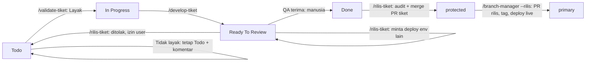
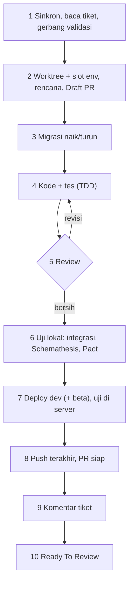

# Alur kerja

## Papan kanban Jira
Setiap tiket bergerak dari kiri ke kanan. Satu kolom = satu status tiket.

| | Todo | In Progress | Ready To Review | Done |
| --- | --- | --- | --- | --- |
| **Artinya** | Tiket baru, belum dicek | Layak dan sedang dikerjakan | Kode + uji + deploy dev/beta selesai, menunggu review manusia | Diterima dan selesai |
| **Perintah** | `/validate-tiket` | `/develop-tiket` | `/rilis-tiket` (feedback QA) | `/rilis-tiket` (merge PR tiket), `/branch-manager --rilis` (rilis versi) |
| **Pindah oleh** | manusia; atau agen (`/rilis-tiket`, izin user) bila ditolak QA | agen (Validator), bila **Layak** | agen (Release) | **manusia saja** |
| **Bukti** | — | laporan validasi + komentar Jira | rencana, laporan uji (request/response/log), PR/MR, versi ter-deploy, komentar Jira | — |

- Agen **tidak pernah** memindah tiket ke Done (guard memblokirnya).
- Tiket ditolak QA kembali ke Todo; `/validate-tiket` masuk **mode validasi ulang** (laporan delta + daftar **Yang ditolak**), `/develop-tiket` melanjutkan di branch dan PR/MR yang sama.
- Tiket biasanya datang dari [workflow produksi tiket](https://claude.ai/artifact/MmaafFo6XZrmLyJGm9ebkx) (contract OpenAPI sudah disetujui); tiket tulisan manual juga diterima.

## Perintah
| Perintah | Flag | Contoh |
| --- | --- | --- |
| `/validate-tiket KODE...` | `--solo` / `--tim` | `/validate-tiket PROJ-12 --tim` |
| `/develop-tiket KODE...` | `--solo` / `--tim`, `--batch` (default) / `--separate` | `/develop-tiket PROJ-12 PROJ-13 --tim` |
| `/rilis-tiket KODE...` | — | `/rilis-tiket PROJ-12` |
| `/branch-manager --rilis KODE` | `--rilis` (lainnya belum ada) | `/branch-manager --rilis PROJ-40` |
| `/audit-issue "teks" [lampiran...]` | `--solo` / `--tim` | `/audit-issue "POST /orders kadang 500" --solo log.txt` |

| Flag | Artinya |
| --- | --- |
| `--solo` | Satu agen mengerjakan semuanya |
| `--tim` | Teammate per peran (Planner, Coder, Reviewer, QA, Release; validasi: PdM, Contract Runner, HoE, PjM) |
| (tanpa flag) | SPV memilih: tiket kecil tanpa migrasi = solo, selain itu tim |
| `--batch` | Semua tiket: satu rencana, satu branch batch lokal, **satu deploy dev**, QA bersama |
| `--separate` | Tiap tiket jalur sendiri, deploy dev per tiket (antre kunci `deploy:dev`) |

`--uat` dari Mobile tidak ada: uji oleh manusia dilakukan lewat klien (Mobile/Frontend web).

## `/develop-tiket`: sepuluh langkah

| # | Langkah | Siapa | Hasil |
| --- | --- | --- | --- |
| 1 | Sinkron dokumen, baca tiket, laporan validasi, tiket terkait | SPV | Gerbang validasi lolos + Acuan tiket |
| 2 | Worktree + branch + **slot env**, Matriks env, rencana + TC + rencana migrasi + kompatibilitas klien, Draft PR/MR | Planner (tim) / SPV (solo), Contract Runner, Release | Dokumen rencana + Draft PR/MR |
| 3 | Migrasi naik dan turun, diuji bolak-balik di database uji | Coder | File migrasi yang bisa dibatalkan |
| 4 | Kode dengan tes dulu di branch tiket | Coder | Commit di-push rutin |
| 5 | Review: performa query, validasi input + otorisasi, logika vs aturan bisnis + contract + klien lama | Reviewer | Komentar review di PR/MR |
| 6 | Tes integrasi, Schemathesis, Pact sebagai penyedia, di layanan lokal slot | QA | Bagian laporan uji |
| 7 | Deploy dev selalu, beta juga (production hanya dengan izin); TC di server dalam kunci `deploy:<env>`; lalu putuskan selesai + publikasi laporan uji | Release, QA, lalu SPV | Versi ter-deploy, hasil TC per server, link laporan uji |
| 8 | Push terakhir, PR/MR ditandai siap | Release | Link PR/MR |
| 9 | Rangkum link di komentar tiket | Release | Komentar Jira |
| 10 | Geser tiket, bersihkan slot + database uji + worktree | Release, SPV | Ready To Review |

Planner menemukan **contract tidak bisa dipenuhi** → alur berhenti. Contract tidak diubah di sini: operator menjalankan `/modify-epic-ticket` di workflow produksi tiket.

## `/validate-tiket`
1. Baca tiket + jejak pengerjaan sebelumnya.
2. **Bug:** reproduksi lewat request ke dev (beta/live hanya method aman) + log + data. **Fitur:** requirement, contract, kebutuhan migrasi, klien terdampak.
3. Laporan berisi bukti tekstual, komentar Jira: **Layak** / **Layak dengan catatan** / **Tidak layak**.
4. Layak → In Progress. Tidak layak → tetap Todo.

Mode tim: PdM (bisnis), Contract Runner (Schemathesis/Pact/diff spec), HoE (blueprint, data, klien, reproduksi), PjM (ketergantungan, tiket klien yang menunggu), Spesialis eskalasi hanya saat pemicu. Product Designer tidak dipanggil.

## `/rilis-tiket`
Baca feedback QA terakhir tiap tiket: **ditolak** → Todo (izin user); **minta env lain** → cek Matriks env lalu deploy beta (production dengan izin); **Done** → audit (approved, CI, migrasi, kompatibilitas, Matriks env beta) lalu merge PR tiket setelah "ya".

## `/branch-manager --rilis`
Tracing commit → tiket, cek migrasi + kompatibilitas + klien yang menunggu, Matriks env live, regresi penuh di beta, laporan rilis, PR rilis. User: **Konfirmasi / Tolak / Ikuti rekomendasi**. Manusia merge PR rilis → tag `vX.Y.Z` → deploy live (izin atau pipeline) → smoke live.

## `/audit-issue`
Hanya-baca: telusuri kode, git, log, reproduksi lewat request (tanpa container, tanpa deploy). Hasil: satu laporan + saran tiket Jira.

## Urutan rilis dengan klien
- **Backend lebih dulu:** endpoint baru ada di live sebelum Mobile/Frontend web yang memakainya dirilis.
- **Perubahan yang memutus kompatibilitas dipecah tiga tahap:** tambah yang baru → tunggu klien berpindah → hapus yang lama. Aplikasi mobile versi lama tidak bisa dipaksa memperbarui diri.
- **Migrasi production dijalankan manusia atau pipeline.** Agen menulis dan menguji migrasi, tidak menjalankannya di production.

---
[← kembali ke README](../README.md)
