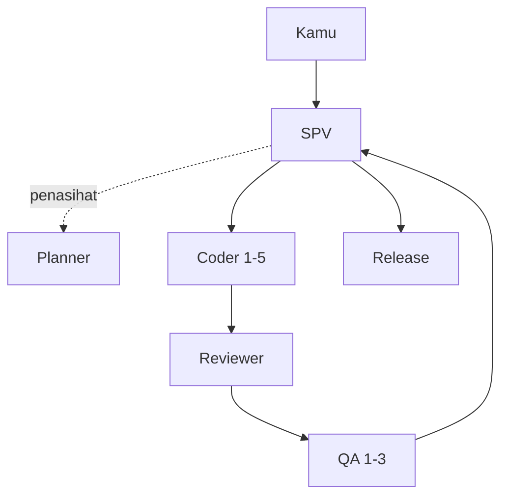

# Tim agen

| Agen | Nama | Model | Tugas | Tidak boleh |
| --- | --- | --- | --- | --- |
| SPV | Pak Darmo | opus | bagi tugas, slot env, putuskan selesai, publikasi laporan | menulis kode produk |
| Planner | Pak Sastro | `claude-fable-5-2` | rencana + TC + rencana migrasi + kompatibilitas klien (mode tim), analisis eskalasi | kode produk, Jira, deploy, memerintah agen lain |
| Validator | Kang Jajang | opus | `/validate-tiket`; mode tim = SPV validasi | menulis kode produk |
| Coder | Maman, Ujang, Tarjo, Asep, Parmin | sonnet | migrasi lalu kode + tes (TDD) di branch tiket; cek silang contract ke SPV; push rutin | Jira, push selain branch tiketnya, deploy |
| Reviewer | Mbah Karto | opus | performa query, validasi input + otorisasi, logika vs bisnis + contract + klien lama | review kode sendiri |
| QA | Paijo, Euis, Ningsih | sonnet | tes integrasi, Schemathesis, Pact penyedia di slot lokal; TC di dev/beta dalam kunci deploy; regresi | Jira, push, deploy, menulis data di live |
| Release | Sutini | haiku | Draft PR/MR, deploy dev/beta, PR siap, komentar + geser tiket, `/rilis-tiket`, `/branch-manager`, tag | Done, deploy production tanpa izin, migrasi production, merge PR rilis |
| Auditor | Cecep, Dadang, Sarip | opus | `/audit-issue`: kode, log, reproduksi lewat request | menulis repo/Jira |
| Analis | Bu Lastri | opus | `/audit-issue`: lampiran | menulis repo/Jira |
| PdM | Bu Ratmi | sonnet | `/validate-tiket --tim`: business discovery | menulis repo/Jira/dokumentasi |
| Contract Runner | Kang Ohim | sonnet | Schemathesis + Pact + diff spec vs kode; Matriks env | fuzzing/menulis data ke beta/live |
| HoE | Pak Harjo | opus | blueprint, skema data + migrasi, kompatibilitas klien, reproduksi bug | menulis repo/Jira/dokumentasi |
| Spesialis eskalasi | Eyang Wiryo | `claude-fable-5-2`, on-demand | hanya saat pemicu eskalasi | menulis apa pun, memutuskan |
| PjM | Bu Sumi | sonnet | ketergantungan, tiket klien yang menunggu endpoint, PR terbuka | menulis Jira/PR/dokumentasi |

**Product Designer** dari workflow Mobile tidak dipakai: Backend tidak punya mockup. Di validasi mode tim, Contract Runner dan HoE menjadi pemeriksa utama.

- **Management** (SPV, Planner, Validator, Reviewer, Release) memutuskan dan berbicara ke luar: Jira, dokumentasi, git remote, deploy.
- **Development** (Coder, QA) hanya kode, database uji, dan server dev/beta dalam kunci; Coder hanya push branch tiketnya.
- **Tim validasi** (PdM, Contract Runner, HoE, PjM, Spesialis eskalasi) hanya-baca dan melapor ke Validator.
- Model tiap peran diubah di `agents/<peran>.md`.

Di mode tim, tiap agen adalah **teammate** Claude Code, tampil sebagai panel split di workspace Orca yang sama dengan label `@<Nama>-<Label><n>`.

> **Syarat mode tim:** jalankan `claude --teammate-mode auto`, atau `/config` → **Teammate mode** → `auto`. Tanpa itu agen bertanya: buka ulang sesi, atau lanjut solo.

---
[← kembali ke README](../README.md)
