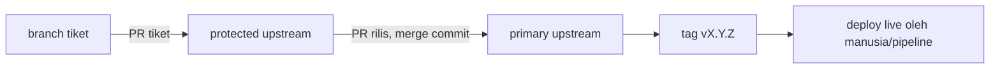

# Deploy, PR/MR, dan rilis

Pengganti `build-release.md` di workflow Mobile. Hanya **Release** yang deploy, push (selain branch tiket Coder), dan membuat PR/MR. Tidak ada nomor build: versi Backend dikenali dari **tag `vX.Y.Z` + hash commit**.

## Versi yang ter-deploy
| Deploy | Versi yang dicatat |
|---|---|
| Dev / beta dari branch tiket | `<branch>@<sha7>` |
| Dev / beta dari branch batch | `batch/<slug>@<sha7>` + daftar KODE |
| Live | `vX.Y.Z` (`<sha-rilis>`) |

Setelah deploy, cocokkan versi yang benar-benar jalan dengan cara dari memory project (mis. `GET /version`, label image, `kubectl get deploy -o jsonpath`). Tidak cocok → deploy belum selesai atau tertimpa; tunggu sebentar, lalu lapor.

## Deploy per tiket (`/deploy-service`, `/deploy-variant`)
- **Dev**: selalu. **Beta**: juga, setelah dev lulus. **Production**: hanya setelah izin eksplisit user per deploy, tidak pernah otomatis.
- Perintah deploy per env dari memory project (Perintah project). Tidak ada → tanya; jangan menebak pipeline.
- Antre server: kunci `deploy:<env>` (`environments.md` → Server bersama). Kunci dipegang dari deploy sampai uji QA di server itu selesai.
- Migrasi di dev/beta: ikut deploy bila pipeline project menjalankannya; manual hanya dengan perintah dari memory project dan hanya ke dev/beta. **Migrasi production tidak pernah dijalankan agen** (guard memblokirnya); pemiliknya (manusia/pipeline) dicatat di memory project.
- `--batch` (default): satu deploy dev dari branch batch, setelah semua tiket lolos review atau dikeluarkan. `--separate`: satu deploy dev per tiket dari worktree tiketnya, antre `deploy:dev`.
- Catatan deploy (deskripsi PR, komentar tiket, laporan) menyebut **env + base URL + versi** tiap deploy, tanpa kredensial.

## PR/MR
- Push hanya ke `origin` (downstream): `git push origin <branch>`.
- Tujuan PR/MR: upstream, base `<protected>` (memory project). Tidak ada branch rilis.
- Dibuat **Draft** di awal pengerjaan (`/develop-tiket` langkah 2), diperbarui oleh push rutin Coder, ditandai siap di akhir (`gh pr ready` / `glab mr update <n> --ready`). Judul berisi kode tiket. Isi: ringkasan, link rencana dan laporan uji, **migrasi** (file, naik/turun teruji, merusak data atau tidak), **kompatibilitas klien** (hasil `/check-compat`), Matriks env, versi yang ter-deploy per env. Tanpa kredensial.
- Branch batch tidak pernah jadi sumber PR/MR; tiap PR/MR dari branch tiketnya sendiri.

## Merge PR tiket (/rilis-tiket)
Agen hanya merge PR tiket ke `<protected>` bila **semua** syarat ini lolos; gagal satu → lapor + saran, tidak merge.

| Syarat | Cara cek |
|---|---|
| Tiket Done dan punya PR/MR | platform tiket + `gh pr list` / `glab mr list` |
| PR/MR approved | `gh pr view` / `glab mr view` |
| CI hijau | status check PR/MR |
| Isi diff sesuai tiket | baca diff vs AC; `manifest-check.sh <base> <head> KODE...` bila perlu |
| Migrasi aman | `migration-lint.sh` pada file migrasi diff: bersih, atau bagian merusak data sudah disetujui user (tercatat di PR/MR) |
| Kompatibilitas klien | `/check-compat` tidak **Memutus**, atau tahap tiga-tahap yang disetujui tercatat |
| Matriks env beta **Sesuai kontrak** | cek ulang di server beta (method aman) |

- Strategi merge sesuai memory project (squash atau merge commit); tracing rilis mendukung keduanya.
- Merge PR rilis ke `<primary>` bukan wewenang agen.

## Rilis (/branch-manager)

- PR rilis `<protected>` → `<primary>` di upstream, **merge commit, bukan squash**, supaya `<primary>` tetap terkandung di `<protected>`. Upstream hanya squash → berhenti dan tanya. Dibuat tanpa push branch, **di-merge manusia**.
- Tracing: `$AGENT_WORKFLOW_DIR/bin/release-trace.sh <primary-ref> <protected-ref> PROJ ...` (TSV sha7/pr/kode/author/subject). Exit 0 = semua terlacak; 1 = ada baris tak terlacak (tandai); 2 = salah pakai/ref tidak ada; 3 = `<primary>` bukan leluhur `<protected>` (hotfix belum di-back-merge) → berhenti dan tanya.
- **Urutan dengan klien** (alasan utama Backend punya aturan sendiri):
  1. **Backend lebih dulu.** Endpoint baru harus ada di live sebelum Mobile/Frontend web yang memakainya dirilis. Laporan rilis mendaftar tiket klien yang menunggu rilis ini (PjM/`/validate-tiket`, tiket terkait).
  2. **Perubahan yang memutus kompatibilitas dipecah tiga tahap**: tambah yang baru → tunggu klien berpindah (versi klien tertua yang didukung, memory project) → hapus yang lama. Rilis yang memuat tahap "hapus" sebelum klien berpindah → rekomendasi **tunda**.
  3. **Migrasi production dijalankan manusia atau pipeline** sesuai memory project; rilis menyebut migrasi yang ikut dan urutannya terhadap deploy (sebelum/sesudah kode baru).
- Regresi penuh suite API di **beta** dari `<sha-rilis>` sebelum user ditanya; smoke live (flow `smoke-live`, method aman saja) setelah deploy live dan sebelum tag dianggap final.
- Deploy live dari `<sha-rilis>`: hanya dengan izin eksplisit user per deploy, dan hanya bila pipeline project memang dijalankan agen (memory project). Bila deploy live milik manusia/pipeline → agen menyiapkan semuanya, lalu menunggu.
- Setelah PR rilis merged oleh manusia: tag beranotasi `vX.Y.Z` di commit merge, push ke `upstream` dan `origin`. Tag tidak pernah ditimpa.
- **Keluarkan tiket dari rilis**: PR revert ke `<protected>` dari branch `revert/<KODE>-<n>` di downstream (`<n>` = nomor urut, mulai 1), judul `revert: <KODE> keluar dari rilis vX.Y.Z`; merge hanya setelah "ya". Tiket yang punya **migrasi** tidak cukup di-revert kodenya: migrasi yang sudah jalan di beta perlu migrasi turun atau migrasi baru → berhenti dan tanya. Tracing diulang setelah ter-merge.
- Tiket itu Done lagi → PR **revert dari revert** (branch `unrevert/<KODE>-<n>`) dulu sebelum dihitung masuk rilis berikutnya.
- Hotfix: sementara manual dengan bertanya.

## Tiket setelah rilis
Komentar (baris pertama link laporan) berisi link PR/MR, versi + env yang ter-deploy, lalu geser ke Ready To Review. Done hanya oleh kolega.
