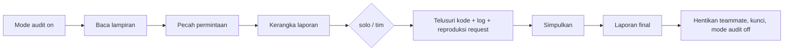

Audit permintaan di `$ARGUMENTS`: teks dalam tanda kutip, flag `--solo`/`--tim` (opsional), lalu path/link lampiran (opsional). Peranmu = **SPV audit**. Audit **hanya-baca**: tidak mengubah repo, tidak membuat/mengomentari/memindah tiket Jira, tidak deploy, tidak menjalankan migrasi, tidak menyalakan container. Guard memaksanya selama mode audit menyala.

Baca dulu (jangan disalin ke sini): `~/.claude/skills/_backend-workflow-shared/rules.md`, `environments.md`, `credentials.md`, `report-format.md` (→ "Laporan audit"), `deploy-release.md`, dan `~/.claude/agents/auditor.md`, `~/.claude/agents/analis.md`. Skrip: `$AGENT_WORKFLOW_DIR/bin/<skrip>`.

**Model:** `claude-opus-5-5` untuk semua peran (sesi ini dan semua teammate).

## Langkah
0. **Cek awal:**
   - `AGENT_LOCK_PID=$PPID "$AGENT_WORKFLOW_DIR/bin/audit-mode.sh" on` sebelum apa pun.
   - Slug = `<yyyymmdd-hhmm>-<3 kata pertama permintaan, huruf kecil, spasi → ->`; `mkdir -p "${TMPDIR:-/tmp}/audit/<slug>"`. Semua file kerja hanya di sana.
   - Tempat jalan: root project atau workspace domain. Repo layanan dari `orca worktree list --json` / folder project; beberapa layanan dan tidak jelas → tanya dengan satu saran.
   - Baca semua lampiran (log, screenshot klien, HAR, PDF, contract). Lampiran yang ditempel di chat hanya terlihat oleh sesi ini: telaah sendiri, beri worker ringkasannya. Gagal dibuka → catat.
1. **Pecah permintaan:** gejala, endpoint/fitur, klien + versi klien bila disebut, waktu kejadian, daftar pertanyaan yang harus dijawab. Kabur → periksa dulu, lalu tanya dengan satu saran.
   - **Versi:** yang disebut di permintaan; tidak ada → versi yang jalan di server terkait (cara dari memory project), atau tag `vX.Y.Z` terbaru (`git fetch --tags`). Kode dibaca di ref itu tanpa checkout. Catat ref-nya.
2. **Kerangka laporan sekarang** (`report-format.md` → Laporan audit): platform `claude-docs` → dokumen dengan blok `pending` per bagian (`mcp__claude_ai_Claude_Docs__batch`), kirim link ke user. Platform `repo` → kerangka di `${TMPDIR:-/tmp}/audit/<slug>/laporan.md`; dipublikasikan di langkah 6 (menulis branch dokumen = bukan menulis repo kode, tetapi dilakukan **setelah** `audit-mode.sh off`).
3. **Pilih mode** (`--solo`/`--tim` memaksa; tanpa flag → satu layanan dan sempit = solo, selain itu tim).
   - **Solo:** sesi ini menjalankan `auditor.md` lalu `analis.md` sendiri, berurutan.
   - **Tim:** teammate (tool Agent dengan `name: "<Nama>-<Label><n>"`, `subagent_type: auditor` atau `analis`, `model: claude-opus-5-5`). Teammate otomatis ikut hanya-baca selama mode audit sesi ini aktif. Auditor (Cecep, Dadang, Sarip; satu per layanan atau per pertanyaan besar), Analis (Bu Lastri) bila ada lampiran, reproduksi memakai nama QA (Paijo, …) dengan `auditor.md`. Isi tugas: "Ikuti `~/.claude/agents/auditor.md`" (atau `analis.md`), slug, repo + ref, pertanyaan, base URL server yang boleh dipakai, akun uji (`lock.sh acquire account:<kunci> audit-<slug>-<peran><n>`), lampiran.
4. **Reproduksi** (bila menyangkut perilaku API): skill `/reproduce-request` di server dev (versi cocok) atau beta/live **hanya method aman**. Tidak ada container/layanan lokal baru dan tidak ada deploy di mode audit; versi itu tidak ada di server mana pun → catat "tidak bisa direproduksi di versi itu", telusuri dari kode + log saja. Permintaan soal dokumen/contract saja → server tidak disentuh.
5. **Simpulkan:** gabungkan `${TMPDIR:-/tmp}/audit/<slug>/*.md`. Akar masalah + keyakinan (**pasti** / **kuat** / **dugaan**), dampak (endpoint, klien + versi, data), perkiraan ukuran perbaikan, perlu migrasi atau tidak. Klaim tanpa bukti = dugaan.
6. **Laporan final:** isi semua bagian, tambah saran tiket Jira (tidak dibuat). Tanpa kredensial. Platform `repo`: matikan mode audit dulu (langkah 7), lalu `docs-publish.sh put <docs-worktree> docs/audit/<slug>.md ...`.
7. **Bersihkan & ringkas:** hentikan semua teammate, lepas kunci akun, lalu `AGENT_LOCK_PID=$PPID "$AGENT_WORKFLOW_DIR/bin/audit-mode.sh" off` sebagai panggilan Bash tersendiri. Di chat: link laporan + satu kalimat kesimpulan.

## Berhenti lebih awal / galat
Sebelum berhenti: hentikan semua teammate, lepas semua kunci, isi bagian laporan yang sudah ada temuannya dan tandai sisanya belum selesai, lalu `AGENT_LOCK_PID=$PPID "$AGENT_WORKFLOW_DIR/bin/audit-mode.sh" off`.

## Tidak pernah
- Membuat, mengedit, mengomentari, atau memindah tiket Jira; menulis Confluence.
- Commit, checkout, branch, worktree, PR/MR, edit file repo, atau menulis ke repo lewat shell (guard tidak menangkap `sed -i`/`>`, jadi ini tanggung jawabmu).
- Deploy, migrasi, menyalakan/menghapus container; method tulis ke beta/live; database production.
