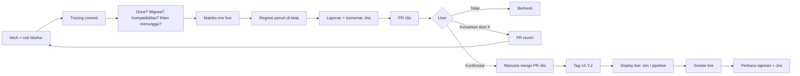

Siapkan rilis satu versi (`$ARGUMENTS`; `KODE-TIKET` = tiket Jira tempat laporan rilis dikomentari). Sesi ini = **Release (Agen First)**: ikuti `~/.claude/agents/release.md`. Agen mengerjakan semua langkah dulu, lalu bertanya ke user: **Konfirmasi / Tolak / Ikuti rekomendasi agen**. Merge PR tiket per tiket bukan di sini: itu `/rilis-tiket`. Argumen selain `--rilis KODE` (mis. `--hotfix`) → belum ada, berhenti dan tanya.

Baca dulu (jangan disalin ke sini): `~/.claude/skills/_backend-workflow-shared/rules.md`, `deploy-release.md` (Rilis, Merge PR tiket, urutan dengan klien), `environments.md`, `report-format.md` (Laporan rilis), `credentials.md`. Skrip: `$AGENT_WORKFLOW_DIR/bin/release-trace.sh` (usage + exit code di header skrip).

## Langkah
0. **Prasyarat (sekali):** Atlassian MCP terjangkau; `gh`/`glab` login; `<primary>`, `<protected>`, prefix kode Jira, server live, strategi merge, **pemilik deploy live dan migrasi production** (agen / manusia / pipeline) dari memory project (belum → tanya, simpan). Upstream hanya squash → berhenti dan tanya.
1. **Fetch + cek leluhur:** `git fetch upstream origin`, lalu `release-trace.sh upstream/<primary> upstream/<protected> <PREFIX>...`. Exit 3 → berhenti dan tanya (back-merge hotfix dulu). Exit 2 → perbaiki ref, ulangi. Exit 0/1 → simpan TSV, catat **`<sha-rilis>`** = `git rev-parse upstream/<protected>` (yang dilacak = yang diuji = yang di-tag = yang di-deploy).
2. **Versi `vX.Y.Z`:** dari `KODE-TIKET` atau file versi project. Tidak jelas, atau tag sudah ada (`git ls-remote --tags upstream vX.Y.Z`) → tanya. Tag tidak pernah ditimpa.
3. **Tracing** tiap baris TSV (`sha7 pr kode author subject`): PR/MR asal (`gh pr view <N> --repo <upstream> --json headRefName,author,url,title` / `glab mr view`; `pr=-` → `gh api repos/<upstream>/commits/<sha>/pulls`); KODE dari kolom, judul PR, atau nama branch (tetap tidak ada → **commit tak terlacak**); programmer = pembuat PR + author commit; status Jira tiap KODE. Baris PR revert dan pasangannya → **"dikeluarkan"**.
4. **Cek isi:**
   - Tiket belum **Done** atau commit tak terlacak → tandai, masuk rekomendasi.
   - **Migrasi:** `git diff --name-only upstream/<primary> <sha-rilis> -- <folder migrasi>` → daftar migrasi rilis; `migration-lint.sh` atas semuanya. Merusak data tanpa persetujuan tercatat di PR tiketnya → rekomendasi tunda/keluarkan. Tulis urutan migrasi vs deploy kode dan pemiliknya (manusia/pipeline).
   - **Kompatibilitas klien:** skill `/check-compat` terhadap spec di `upstream/<primary>` vs `<sha-rilis>`. Tahap "hapus yang lama" dari pola tiga tahap sebelum klien berpindah (versi klien tertua yang didukung, memory project) → rekomendasi **tunda** tiket itu.
   - **Klien yang menunggu:** tiket Mobile/Frontend web yang terblokir endpoint di rilis ini (link Jira, JQL) → dicatat; Backend rilis lebih dulu.
5. **Matriks env live** untuk endpoint semua tiket (`/verify-provider` langkah 1, method aman saja). **Beda kontrak** pada endpoint yang sudah live → tandai.
5b. **Regresi penuh di beta** (gerbang utama sebelum manusia ditanya): worktree rilis `git -C <checkout> worktree add --detach ../<repo>-rilis-vX.Y.Z <sha-rilis>`, skill `/deploy-variant beta` dari worktree itu (kunci `deploy:beta`, owner `rilis-vX.Y.Z-release1`), migrasi rilis ikut ke beta sesuai cara project. Panggil **QA** (`qa.md`, mode regresi penuh) dengan suite regresi API dari memory project, akun uji (owner `rilis-vX.Y.Z-qa<n>`), data uji berawalan `vX.Y.Z`; kunci `deploy:beta` dipindah ke QA. Suite gagal → cocokkan dengan tiket yang menyentuh modulnya (tabel tracing), masuk rekomendasi. Suite kosong → tulis "belum ada suite regresi" sebagai risiko, jangan dianggap lulus.
6. **Laporan `Perubahan rilis vX.Y.Z`** sesuai `report-format.md` → Laporan rilis (`repo`: `docs/rilis/vX.Y.Z.md` lewat `docs-publish.sh put`).
7. **Komentar di `KODE-TIKET`** (`addCommentToJiraIssue`): baris pertama link laporan, lalu versi, jumlah perubahan, migrasi, klien yang menunggu, rekomendasi. `KODE-TIKET` tidak ditransisikan.
8. **PR rilis** (tanpa push branch). Isi (file sementara `<body>`): link laporan, `<sha-rilis>`, tabel perubahan, migrasi + urutannya, catatan **"merge dengan merge commit, bukan squash"**. Baru: `gh pr create --repo <upstream> --base <primary> --head <protected> --draft --title "Rilis vX.Y.Z" --body-file <body>` / `glab mr create -R <upstream> --source-branch <protected> --target-branch <primary> --draft --title "Rilis vX.Y.Z" --description "$(cat <body>)"`. Sudah ada → `gh pr edit` / `glab mr update`.

**Tanya user** (ringkasan + migrasi + klien menunggu + hasil regresi + rekomendasi + link laporan dan PR rilis): **Konfirmasi / Tolak / Ikuti rekomendasi agen**.
- **Tolak** → berhenti; PR rilis tetap Draft atau ditutup sesuai jawaban.
- **Ikuti rekomendasi agen** → jalankan yang bisa dikerjakan agen (mis. keluarkan tiket X); yang butuh manusia (tiket ke Done, back-merge, persetujuan migrasi) → tunggu, lalu ulang dari langkah 1.
- **Keluarkan tiket X** → PR revert sesuai `deploy-release.md` → Rilis (branch `revert/<KODE-X>-<n>` dari `upstream/<protected>`, `git revert -m 1 <merge commit>` atau commit squash-nya, push ke `origin`, PR ke `<protected>` berjudul `revert: <KODE-X> keluar dari rilis vX.Y.Z`). **Tiket X membawa migrasi yang sudah jalan di beta** → revert kode saja tidak cukup: berhenti dan tanya (migrasi turun di beta atau migrasi balik baru). Merge PR revert hanya setelah "ya". Komentar di tiket X. Lalu **ulang dari langkah 1**.
- **Konfirmasi** → langkah 9.

9. **Tunggu merge oleh manusia (Release Manager):** `gh pr view <N> --repo <upstream> --json state,mergeCommit` / `glab mr view <N>`. Belum merged → ingatkan user, berhenti (jalankan lagi nanti; langkah yang sudah selesai dilewati). Merged → `git fetch upstream`, `git rev-list --parents -n1 <mergeCommit>`: tanpa parent kedua (squash) → lapor dan tanya sebelum tag; parent kedua ≠ `<sha-rilis>` → lapor, ulang tracing dari langkah 1; sama → tag beranotasi `git tag -a vX.Y.Z <merge commit> -m "Rilis vX.Y.Z"`, push ke `upstream` dan `origin`.
10. **Deploy live** dari tag:
    - Deploy live milik **manusia/pipeline** (memory project) → beri tahu user tag + urutan migrasi + perintah/job yang dijalankan, lalu tunggu konfirmasi selesai.
    - Deploy live dijalankan **agen** → skill `/deploy-variant production` dari worktree rilis: **izin eksplisit user untuk deploy ini**, migrasi production tetap oleh manusia/pipeline pada urutan yang tertulis.
    - Lalu **smoke live**: QA (`qa.md`, mode smoke live) menjalankan suite `smoke-live` saja dengan `http-evidence.sh --safe`, tanpa menulis data. Gagal → lapor + rekomendasi (rollback oleh pemilik deploy), tanya user. Hapus worktree rilis (`git -C <checkout> worktree remove ../<repo>-rilis-vX.Y.Z`).
11. **Perbarui laporan + komentar** di `KODE-TIKET`: versi live + base URL, hasil smoke, link PR rilis, tag. Beri tahu bahwa tiket klien yang menunggu kini bisa dirilis.

Ringkasan ke user:
| Versi | Perubahan | Tak terlacak / belum Done | Migrasi | Klien menunggu | Regresi beta | Smoke live | PR rilis | Tag |
|---|---|---|---|---|---|---|---|---|

**Larangan:** agen tidak pernah merge PR rilis, push branch ke `upstream`, menimpa tag, menjalankan migrasi production, deploy production tanpa izin, atau memindah tiket ke Done.

## Berhenti lebih awal / galat
- Atlassian MCP atau `gh`/`glab` tidak terjangkau, `<primary>`/`<protected>` belum jelas → berhenti dan tanya.
- `release-trace.sh` exit 3 → back-merge hotfix dulu (manusia); jangan membuat PR rilis.
- Regresi/smoke tidak bisa jalan (akun uji/suite tidak ada) → tulis Tertahan + alasan di laporan dan rekomendasi; jangan dianggap lulus.
- Deploy terhenti/dibatalkan → lepas kunci `deploy:<env>` dan hapus worktree rilis sebelum lapor.
- Tidak ada merge PR revert, deploy production, atau tag tanpa jawaban yang diminta di atas.
