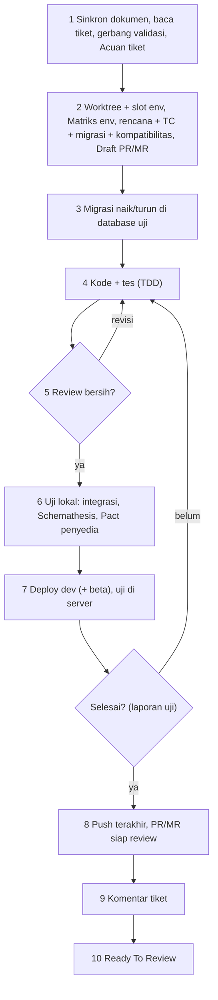

Kerjakan satu atau lebih tiket Backend (`$ARGUMENTS`). Sesi ini = **SPV**: ikuti `~/.claude/agents/spv.md` (tidak menulis kode produk, tidak memindah ke Done).

Baca dulu (jangan disalin ke sini): `~/.claude/skills/_backend-workflow-shared/rules.md`, `ticket-platform.md`, `environments.md`, `credentials.md`, `deploy-release.md`, `report-format.md`, serta `~/.claude/agents/{coder,reviewer,qa,release}.md`. Skrip: `$AGENT_WORKFLOW_DIR/bin/<skrip>` (`AGENT_WORKFLOW_DIR` diisi seperti di `rules.md`). Setiap panggilan `lock.sh`/`env-slot.sh` diawali `AGENT_LOCK_PID=$PPID` di panggilan Bash yang sama.

**Alur** (`--batch` default; terpisah dari `--solo`/`--tim`, boleh digabung):
- **`--batch`:** semua tiket = satu batch: satu rencana, satu branch batch, **satu deploy dev**, QA di deploy itu. Deploy dan uji server jalan sekali untuk semua tiket, di titik tunggu langkah 7 dan 9.
- **`--separate`:** tiap tiket jalur sendiri: rencana, deploy dev dari branch tiket, QA, laporan, selesai sendiri; tanpa branch batch. Deploy tetap antre `deploy:dev`.
- `--uat` dari Mobile **tidak dipakai**: uji oleh manusia dilakukan lewat klien (Mobile/Frontend web) setelah Ready To Review.

## Langkah
0. **Guard:** kenali domain (`rules.md` → Workspace & worktree). Root project atau tidak ketemu → berhenti: "Jalankan dari workspace domain". Tentukan checkout domain (tidak ada → buat sesuai `rules.md`), kunci `checkout:<path>`. Branch batch (`--batch`) = branch checkout domain saat ini (lokal, **tidak pernah** di-push).
1. **Sinkron, baca tiket, gerbang validasi, Acuan tiket** (SPV):
   - **Prasyarat (sekali):** platform tiket siap (`ticket-platform.md` → Cek awal: platform di memory project, none → tanya user); `~/.agent-workflow/board-transitions.json` punya id **Ready To Review** (belum → "Setup status board" di `ticket-platform.md`); `prod-hosts.txt` ada (belum → minta user mengisinya, `rules.md` → Setup host production); memory project lengkap untuk Perintah project, Database uji, Server per env, Contract, Klien (belum → periksa, tanya sekali, simpan). **Syarat stack** (`rules.md`): perintah ekspor spec OpenAPI dari kode ada dan hasilnya lolos `openapi-check.sh validate`; belum → berhenti & tanya dengan saran generator. Akun uji (`credentials.md`); tidak ada → berhenti & tanya.
   - **Sinkron sumber** sama dengan `/validate-tiket` langkah 1 (business discovery, contract/OpenAPI + katalog contract, blueprint, ADR; `git fetch`/`git pull` lalu `graphify update` bila dipakai); catat ref.
   - **Baca tiket** + komentar + tiket terkait/blocking (`ticket-platform.md` → Baca tiket, Cari tiket terkait). Catat per tiket: AC, endpoint, jenis (hotfix atau feature/fix) → `<base>`; tiket klien (Mobile/Frontend web) yang menunggu endpoint ini. Tiket contract (dari workflow produksi tiket) belum Done → tiket ini terblokir: tanya.
   - **Jejak pengerjaan sebelumnya** (tiket kembali ke Todo): ada branch `origin/*/<KODE>` atau `origin/*/<KODE>-r<n>` (tanpa `revert/`/`unrevert/`) atau PR/MR → **wajib baca** komentar review manusia (PR/MR + tiket) sejak putaran terakhir + komentar arahan QA dari `/rilis-tiket` → daftar **Yang ditolak**. Jejak tanpa komentar penolakan → tanya user apa yang ditolak. PR/MR sudah **merged** → branch baru `<jenis>/<KODE>-r<n>` dari base terkini + Draft PR/MR baru yang menyebut yang lama.
   - **Gerbang validasi:** cari komentar laporan validasi terbaru (baris pertama = link) dan **baca laporannya**.
     | Kondisi | Tindakan |
     |---|---|
     | Belum pernah divalidasi | Tanya user: jalankan `/validate-tiket` dulu, atau lanjut dengan cek singkat SPV (dicatat di rencana) |
     | **Tidak layak** | Berhenti & tanya |
     | **Layak dengan catatan** | Tiap catatan masuk rencana dan jadi TC atau tugas |
     | **Layak** | Lanjut |
   - **Dokumen terbaru vs validasi:** contract/aturan bisnis/blueprint berubah sejak validasi dan menyentuh AC atau endpoint → sebut bedanya dan tanya; berubah kecil → catat di rencana.
   - Hasilnya **Acuan tiket**: link/path + ref tiap dokumen (business discovery, contract OpenAPI + versi, blueprint, ADR) + link laporan validasi. Acuan masuk rencana, brief Planner, prompt Coder, tugas QA.
2. **Worktree + slot env, Matriks env, rencana, Draft PR/MR:**
   - **Mode:** `--solo`/`--tim` memaksa; tanpa flag → SPV menilai: 1 tiket kecil tanpa migrasi = solo, selain itu tim.
   - **Worktree tiket** `<repo>-<nomor>` dari `<base>` ref remote terbaru (`rules.md`); ada jejak → pakai branch/worktree/PR yang ada. Lalu **slot env**: `env-slot.sh acquire <worktree> <KODE>-spv1` (port + database uji sendiri, `environments.md`).
   - **Matriks env** endpoint tiket × dev/beta/live (`/verify-provider` langkah 1; tim: **Contract Runner**, solo: SPV). **Beda kontrak** pada endpoint yang sudah ada → sebut dan tanya sebelum rencana.
   - **Rencana** di platform dokumentasi (`report-format.md`; `repo`: `docs/tickets/<KODE>/rencana.md`), berpijak pada worktree + base hash, Acuan tiket, Matriks env. `--batch`: satu dokumen untuk semua tiket (di tiket pertama, tiket lain menautkannya); `--separate`: satu per tiket. Isi wajib Backend selain bagian Mobile (tujuan, pendekatan, tugas, TC, risiko, di luar scope, pertanyaan):
     - **Rencana migrasi**: tabel/kolom/index yang berubah, naik/turun, merusak data atau tidak (perkiraan `migration-lint`), urutan terhadap deploy kode, siapa menjalankan di production (memory project), backfill/tiga tahap bila perlu.
     - **Kompatibilitas klien**: hasil `/check-compat` awal (Aman / Aman dengan catatan / **Memutus** → berhenti & tanya).
     - **TC** per AC, menyebut tempat uji (lokal slot / dev / beta) dan alat (integrasi, Schemathesis, Pact, request manual); TC otorisasi (user lain, peran lain, tanpa token) dan validasi input wajib ada untuk tiap endpoint tulis.
     **Tim:** SPV memanggil **Planner** (`planner.md`) dengan brief; Planner membalas link + ringkasan + status (Siap / Butuh jawaban / Tidak bisa); SPV memeriksanya terhadap slot, antrean deploy, dan batch. **Planner menemukan contract tidak bisa dipenuhi → alur berhenti.** Contract tidak diubah di sini: SPV melapor ke user, operator menjalankan `/modify-epic-ticket` di workflow produksi tiket. **Solo**/tiket kecil: SPV menulis sendiri.
   - **Tiket dengan jejak (revisi):** rencana memuat **Yang ditolak** (tiap poin → tugas/TC); PR/MR yang ada dikembalikan ke Draft (`gh pr ready <n> --undo` / `glab mr update <n> --draft`).
   - **Draft PR/MR per tiket (Release), sebelum Coder mulai** (tiket tanpa jejak): branch belum beda dari base → `git commit --allow-empty -m "chore: <KODE> mulai pengerjaan"`; `git push -u origin <branch tiket>`; `gh pr create --draft` / `glab mr create --draft` ke `<protected>` (`deploy-release.md` → PR/MR). Isi: link rencana, Acuan tiket, Matriks env, rencana migrasi, kompatibilitas.
   - **Solo:** SPV sendiri menjalankan peran Coder → Reviewer (review diff sendiri dengan daftar cek `reviewer.md`, catat bahwa review bukan independen) → QA → Release, berurutan.
   - **Tim:** tiap worker = **teammate** (tool Agent dengan `name: "<Nama>-<Label><n>"`, `subagent_type: <peran>`, `model` dari tabel); lengkapnya `rules.md` → Orkestrasi:
     | Peran | Model | Catatan |
     |---|---|---|
     | Planner | `claude-fable-5-2` (jangan isi `model`) | hanya-baca; langkah 2 dan saat eskalasi, dihentikan setelah membalas |
     | Contract Runner | `claude-sonnet-5-5` | Matriks env; dihentikan setelah membalas |
     | Coder | `claude-sonnet-5-5` | di worktree tiketnya; coder ke-2+ hanya bila file/modul terpisah; **satu coder per tiket pemegang migrasi** |
     | Reviewer | `claude-opus-5-5` | bukan coder tiket itu; tulis review di PR/MR |
     | QA (1-3) | `claude-sonnet-5-5` | uji lokal di slot + uji server |
     | Release | `claude-haiku-5-5` | Draft PR, deploy, PR siap, komentar + status tiket |
     Isi tugas: "Ikuti `~/.claude/agents/<peran>.md`", kode tiket, AC/TC, branch, worktree + slot env, batas file, akun uji, folder laporan.
3. **Migrasi** (tiket yang mengubah skema/data; Coder pemegang migrasi): ikuti skill `/write-migration` (`~/.claude/skills/write-migration/SKILL.md`): database uji slot, migrasi naik + turun, `migration-lint.sh` (merusak data → berhenti, SPV tanya user), `migration-check.sh` bolak-balik. Hasil: file migrasi yang bisa dibatalkan, di-commit + push di branch tiket.
4. **Kode (TDD)** di branch tiket (Coder): sebelum menulis kode kirim **satu daftar cek silang** ke SPV: endpoint yang dibuat/diubah (path, method, field request/response, kode galat, auth) persis menurut contract di Acuan, tabel yang dipakai, perilaku untuk klien lama (`/check-compat`); tunggu jawaban. Tes dulu → kode minimum → rapikan. Endpoint diberi anotasi/deklarasi generator sehingga **spec dari kode** memuatnya; sebelum lapor: ekspor spec, `openapi-check.sh validate`, lalu `openapi-check.sh diff <contract> <spec kode> --paths <endpoint tiket>` bersih. Commit kecil (pesan menyebut KODE) dan **push rutin** `git push origin <branch tiket>`. Seluruh tes project lulus (database uji slot) sebelum lapor.
5. **Review** (Reviewer) diff branch tiket, prioritas: (1) **performa query** (N+1, query tanpa index, scan besar, transaksi panjang, lock tabel di migrasi); (2) **validasi input dan otorisasi** (setiap endpoint tulis memeriksa pemilik/peran, mass assignment, injeksi, data sensitif di log/response, rate limit bila contract menyebut); (3) **logika vs aturan bisnis dan AC**, kontrak dipakai persis (hasil `openapi-check.sh diff` bersih, anotasi spec sesuai perilaku kode), kompatibilitas klien lama (`/check-compat`). Review ditulis di PR/MR (satu komentar per putaran, tabel temuan); temuan **wajib** → kembali ke langkah 4. Lewat 2 putaran revisi (tim) → SPV memanggil Planner (akar masalah + revisi rencana); rencana sudah direvisi 2 kali dan masih gagal → berhenti & tanya.
6. **Uji lokal** (QA) di worktree tiket + slot env, folder `${TMPDIR:-/tmp}/qa/<KODE>/`:
   - Skill `/test-integration`: migrasi terbaru di database uji, tes unit + integrasi, TC lokal dengan bukti `http-evidence.sh`, regresi area terdampak (`area-<modul>`).
   - **Spec dari kode** (skill `/verify-provider` langkah 0): ekspor, `openapi-check.sh validate`, `openapi-check.sh diff` terhadap contract; beda = gagal.
   - Skill `/verify-provider` langkah 2–3 terhadap **layanan lokal** di `APP_PORT`: Schemathesis endpoint tiket (penuh) dan Pact sebagai penyedia untuk semua klien yang menyentuh endpoint tiket.
   - Gagal → kembali ke langkah 4. TC tidak bisa dijalankan / AC tidak teruji (tim) → SPV minta Planner merevisi TC.
7. **Deploy + uji server** (Release, lalu QA):
   - `--batch`: **titik tunggu.** Branch batch: di checkout domain `git merge --no-ff <branch tiket>` untuk tiap tiket yang lolos langkah 6 (salinan lokal untuk deploy; PR tetap dari branch tiket; perbaikan selalu di branch tiket lalu merge ulang; konflik → berhenti & tanya). Deploy hanya setelah **semua** tiket lolos atau dikeluarkan (alasan tertulis di rencana). Satu deploy dari branch batch.
   - `--separate`: satu deploy per tiket dari worktree tiketnya.
   - **Dev selalu:** skill `/deploy-service` (kunci `deploy:dev` → deploy → cocokkan versi → serahkan kunci ke QA). QA menjalankan TC dev (`/verify-provider` langkah 2 di base URL dev + TC yang butuh server dev), lalu melepas `deploy:dev`.
   - **Beta juga:** setelah dev lulus, skill `/deploy-variant beta` (kunci `deploy:beta`, QA TC beta dengan akun uji, method tulis hanya data berawalan KODE).
   - **Production:** hanya dengan izin eksplisit user per deploy (`/deploy-variant production`); di `/develop-tiket` normalnya tidak, karena production lewat `/branch-manager`.
   - Laporan uji: tabel TC × server (lokal/dev/beta) + versi ter-deploy, Matriks env diperbarui bila hasil berbeda.
   **Putuskan selesai** (SPV, per tiket, akhir langkah 7) hanya bila: semua TC AC **Lulus** atau **Tertahan** dengan alasan tertulis; migrasi teruji bolak-balik dan (bila merusak data) disetujui user; `/check-compat` tidak Memutus; review tanpa temuan wajib; tes project lulus. Belum → ulangi 4–7 untuk tiket itu:
   - `--batch`: **titik tunggu.** Perbaiki dan review semua tiket yang gagal, merge ulang, **satu** deploy ulang; QA ulang tiket yang diperbaiki, tiket lain cukup cek singkat.
   - Tiket macet (butuh jawaban, blocking) → keluarkan dari batch, laporkan statusnya.
   - Lalu SPV publikasikan **laporan uji** per tiket (`report-format.md` → Laporan uji; `repo`: `docs/tickets/<KODE>/uji.md` lewat `docs-publish.sh put`). **Tunggu link kembali**; tanpa link → jangan komentar tiket.
   - Ada keputusan teknis yang layak diingat (pola baru, trade-off) → ADR di branch tiket (`docs/adr/`), ikut PR.
8. **Push terakhir + PR/MR siap review** (Release): `git push origin <branch tiket>` (branch batch tidak di-push), perbarui isi Draft PR/MR (laporan uji, migrasi, kompatibilitas, Matriks env, versi ter-deploy per env), tandai siap (`gh pr ready <n>` / `glab mr update <n> --ready`). Belum ada Draft (cadangan) → buat seperti langkah 2 tanpa `--draft`.
9. **Komentar tiket** (Release, komentar tiket (`ticket-platform.md`)) per tiket: baris pertama link laporan, lalu link rencana, env + base URL + versi tiap deploy, PR/MR, ringkasan Lulus/Tertahan, dan (bila ada) tiket klien yang kini bisa lanjut.
10. **Ready To Review** (`ticket-platform.md` → Geser status, nilai dari `board-transitions.json`). Tidak pernah Done. Lalu **bersihkan & ringkas**: `test-db.sh down` + `env-slot.sh release` + hapus worktree tiket buatan batch ini yang bersih dan sudah di-push (`rules.md`); hentikan semua teammate; pastikan semua kunci (`deploy:*`, `slot:*`, `account:*`, `checkout:*`) dilepas.

   | KODE | Status | Laporan | Deploy (env@versi) | PR/MR |
   |---|---|---|---|---|

## Berhenti lebih awal / galat
Sebelum berhenti (guard, tanya, galat, user membatalkan): lepas semua kunci milik batch ini (`AGENT_LOCK_PID=$PPID "$AGENT_WORKFLOW_DIR/bin/lock.sh" release <resource> <owner>` untuk `deploy:*`, `account:*`, `checkout:*`), biarkan slot env + database uji bila pekerjaan akan dilanjutkan (sebut di laporan) atau `test-db.sh down` + `env-slot.sh release` bila dibatalkan, minta teammate melakukan hal sama lalu hentikan mereka, dan laporkan posisi terakhir per tiket. Pertanyaan wajib (`rules.md`): SPV tanya di chat dengan ringkasan + saran; teammate bertanya lewat SPV.
