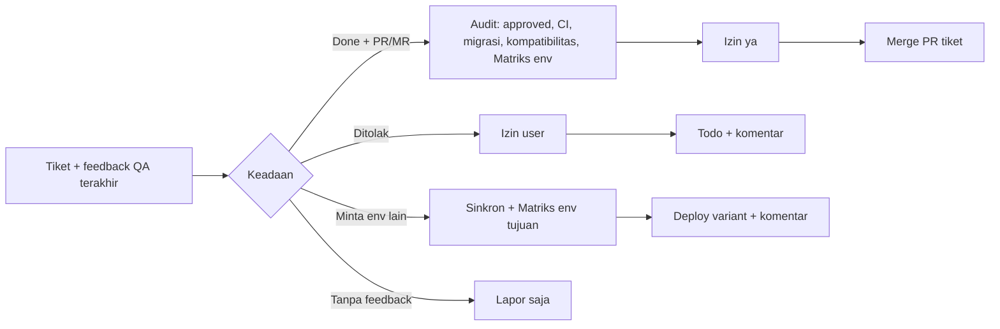

Tindak lanjuti feedback QA untuk satu atau lebih tiket (`$ARGUMENTS`). Sesi ini = **Release**: ikuti `~/.claude/agents/release.md`. Keputusan (izin Todo, izin merge, izin production) ke user lewat chat: ringkasan + satu saran. Rilis per versi (PR rilis, tag) bukan di sini: itu `/branch-manager --rilis`.

Baca dulu (jangan disalin ke sini): `~/.claude/skills/_backend-workflow-shared/rules.md`, `deploy-release.md` (Merge PR tiket), `environments.md`, `report-format.md`, `credentials.md`. Skrip: `$AGENT_WORKFLOW_DIR/bin/<skrip>`. Remote: `origin` = downstream (fork), `upstream` = repo utama.

## Langkah
0. **Prasyarat (sekali):** Atlassian MCP terjangkau; `jira-transitions.json` punya id **Todo**; `<primary>`/`<protected>`, strategi merge PR tiket, perintah deploy per env dari memory project (belum → tanya, simpan). `git fetch upstream origin`.
1. **Per tiket, baca keadaan:** `getJiraIssue` + komentar (status Ready To Review/Done; lainnya → lapor dan lewati), PR/MR-nya + komentar review. **Feedback QA terakhir** = komentar manusia terbaru (Jira + PR/MR) setelah komentar agen terakhir. QA Backend biasanya menguji lewat klien (Mobile/Frontend web): feedback yang menyebut layar → petakan ke endpoint/request yang dipakai layar itu sebelum menyimpulkan.
2. **Pilih tindakan:**
   | Keadaan | Tindakan |
   |---|---|
   | Ditolak QA | 3a |
   | Positif, belum Done, QA minta deploy ke env lain (beta/production) | 3b |
   | Done + punya PR/MR | 3c |
   | Positif tanpa permintaan deploy (belum Done) | Lapor saja |
   | Tidak ada feedback QA | Lapor, tidak ada tindakan |
   Beberapa keadaan sekaligus → urutan **Done > ditolak > minta deploy**. Feedback bertentangan → tanya user.
3. **Tindakan:**
   - **3a Ditolak:** ringkas arahan QA (apa yang ditolak, dari siapa, di mana; bug di klien vs bug di Backend dibedakan, dengan bukti request bila bisa). Minta izin user; "ya" → `transitionJiraIssue` ke **Todo** + komentar ringkasan arahan (baris pertama link PR/MR). Masalahnya ternyata di klien → jangan Todo-kan tiket Backend; saran: tiket di klien. Putaran berikutnya lewat `/validate-tiket` (validasi ulang) lalu `/develop-tiket`.
   - **3b Minta deploy env lain:**
     1. **Sinkron dokumen** sama dengan `/validate-tiket` langkah 1 (contract, blueprint; catat ref).
     2. **Cek ulang Matriks env** server tujuan (`/verify-provider` langkah 1, method aman). **Beda kontrak** di server tujuan → berhenti dan tanya.
     3. Pastikan isi tiket ada di sumber deploy (branch tiket di `origin`). Worktree tiket `<repo>-<nomor>` sudah dihapus → buat ulang sejajar checkout domain: branch lokal ada → worktree di branch itu lalu `git -C <worktree> merge --ff-only origin/<branch tiket>` (tidak bisa fast-forward → berhenti dan tanya); belum ada → `-b <jenis>/<KODE> origin/<branch tiket>`.
     4. Skill `/deploy-variant <env>` (`~/.claude/skills/deploy-variant/SKILL.md`): beta → deploy + uji beta; **production → izin eksplisit dulu**, migrasi production oleh manusia/pipeline. Hapus worktree lagi bila bersih dan sudah di-push.
     5. Komentar Jira (baris pertama link laporan/deploy) menyebut **env + base URL + versi**, tanpa kredensial.
   - **3c Done:** audit sesuai tabel `deploy-release.md` → Merge PR tiket (approved, CI hijau, diff sesuai tiket, `migration-lint.sh` bersih atau persetujuan tercatat, `/check-compat` tidak Memutus, Matriks env beta **Sesuai kontrak**).
     - Cek PR revert: `gh pr list --repo <upstream> --state merged --limit 200 --json headRefName --jq '.[].headRefName' | grep -E '^(un)?revert/<KODE>-[0-9]+$'` (GitLab: `glab mr list --merged -F json` lalu `source_branch`). Ada `revert/<KODE>-<n>` tanpa pasangan `unrevert/<KODE>-<n>` → buat PR **revert dari revert** (`deploy-release.md` → Rilis) dan merge setelah "ya"; baru PR tiket.
     - Lolos → minta "ya" user, lalu merge: `gh pr merge <n> --repo <upstream> --squash|--merge` / `glab mr merge <n>`, strategi dari memory; belum tercatat → tanya. Gagal satu syarat → lapor + saran, tidak merge. Komentar Jira (link PR + commit merge).
4. **Ringkasan** ke user:
   | KODE | Feedback | Tindakan | Deploy/PR | Status |
   |---|---|---|---|---|

Agen tidak pernah memindah tiket ke Done, tidak pernah merge PR rilis ke `<primary>`, dan tidak pernah menjalankan migrasi production.

## Berhenti lebih awal / galat
- Atlassian MCP atau `gh`/`glab` tidak terjangkau, id Todo belum ada → berhenti dan tanya.
- Deploy terhenti/dibatalkan → lepas kunci `deploy:<env>` sebelum lapor.
- Tidak ada yang di-merge atau di-deploy tanpa jawaban "ya" yang diminta di atas.
