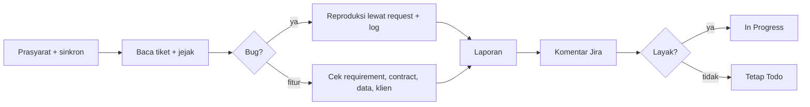

Validasi satu atau lebih tiket Jira Backend (`$ARGUMENTS`). Peranmu = **Validator**; di mode tim kamu juga **SPV** (orchestrator). Tidak menulis kode produk, tidak memindah tiket ke Done.

Baca dulu (jangan disalin ke sini): `~/.claude/skills/_backend-workflow-shared/rules.md`, `environments.md`, `credentials.md`, `report-format.md`, `deploy-release.md`, dan `~/.claude/agents/validator.md`; mode tim juga `~/.claude/agents/{pdm,contract-runner,hoe,pjm,eskalasi}.md`. Skrip: `$AGENT_WORKFLOW_DIR/bin/<skrip>`.

**Mode:** sesi ini bertindak langsung sebagai Validator/SPV (bukan subagen `validator`), supaya akses Jira dan dokumentasi tetap di satu tempat. Tiket berurutan.
- `--solo` (atau tanpa flag untuk tiket kecil/jelas, satu endpoint, tanpa migrasi): sesi ini mengerjakan semua langkah sendiri.
- `--tim` (tanpa flag: tiket yang menyentuh aturan bisnis + contract + data, atau bug lintas layanan): langkah 4 dibagi ke teammate, lihat "Mode tim". Product Designer **tidak dipanggil** (tidak ada mockup); Contract Runner dan HoE pemeriksa utama.

## Langkah
1. **Prasyarat (sekali, sebelum tiket pertama):**
   - Atlassian MCP terjangkau (`mcp__claude_ai_Atlassian__atlassianUserInfo`); gagal → berhenti, lapor.
   - `~/.agent-workflow/jira-transitions.json` punya entri project; belum → "Setup transisi Jira" di `rules.md`.
   - Memory project: Server per env, Contract, Klien, Platform dokumentasi (belum → periksa, tanya sekali, simpan). `prod-hosts.txt` belum ada → minta user mengisinya sebelum menyentuh beta/live.
   - Akun uji (`credentials.md`) bila ada tiket bug; tidak ditemukan → berhenti & tanya.
   - **Sinkron sumber (sekali per sesi):** business discovery, contract (spec OpenAPI + `contract.json`/katalog contract dari workflow produksi tiket), blueprint, ADR. Repo yang sama dengan kode → `git fetch upstream` lalu baca dari `upstream/<protected>` tanpa checkout; repo dokumen terpisah → `git pull` di checkout dokumen itu (bukan worktree primary). Lalu `graphify update` bila project memakainya. Catat ref yang dibaca.
   - Platform `repo`: `docs-publish.sh init <checkout>` sekali → worktree dokumen.
2. **Per tiket, berurutan.** Ulangi 3–8 untuk tiap KODE; satu laporan per tiket.
3. **Baca** tiket, komentar, dan link terkait (`mcp__claude_ai_Atlassian__getJiraIssue`). Catat AC, endpoint, versi yang tertulis, dan tiket contract induknya (tiket ini sering berasal dari workflow produksi tiket; tiket tulisan manual juga diterima).
   **Deteksi jejak** (tiap tiket): branch `git branch -r --list 'origin/*/<KODE>*' | grep -E '/<KODE>(-r[0-9]+)?$' | grep -vE 'origin/(un)?revert/'`, PR/MR `gh pr list --state all --search <KODE>` / `glab mr list --all --search <KODE>`, dan komentar Jira berisi laporan uji/rencana agen. Ada → **mode validasi ulang**: baca penolakan sejak putaran terakhir (komentar arahan QA di Jira dari `/rilis-tiket` + review PR/MR manusia), lalu **golongkan** tiap poin:
   | Golongan | Tindakan |
   |---|---|
   | **Implementasi meleset** (requirement tetap) | **Layak**; daftar revisi masuk "Yang ditolak" |
   | **Requirement/contract berubah atau kurang** | Cek ulang terhadap dokumen terbaru; contract perlu diubah → **Tidak layak** sampai `/modify-epic-ticket` dijalankan di workflow produksi tiket; tidak jelas → tanya user/PM |
   Jejak tanpa komentar penolakan → tanya user apa yang ditolak. PR/MR sudah **merged** → pengerjaan lewat branch baru `<jenis>/<KODE>-r<n>` + Draft PR/MR baru.
4. **Bug:** tentukan versi dari tiket (kosong → versi yang jalan di dev/beta, `deploy-release.md`). Reproduksi dengan skill `/reproduce-request` (`~/.claude/skills/reproduce-request/SKILL.md`): request ke dev (atau beta/live hanya method aman), log, data; bukti tekstual tiap langkah.
   **Fitur:** cek requirement lengkap; **contract** ada dan cukup (endpoint, field, kode galat, auth, batas data; versi contract disetujui); **data**: tabel yang disentuh, perlu migrasi atau tidak, migrasi merusak data atau tidak (perkiraan); **klien**: siapa memakai endpoint ini, versi klien lama yang terdampak (`/check-compat` versi ringan: baca spec + kode, tanpa branch).
   **Tiket terkait (solo dan tim):** selain link yang ada, cari tiket Todo/In Progress yang tidak di-link tapi menyentuh endpoint/tabel/modul yang sama (JQL `text ~`), termasuk tiket klien yang menunggu endpoint ini; mode tim dikerjakan PjM. Link antar tiket tidak dibuat sendiri: cukup disarankan di komentar.
   **Aturan keputusan:**
   | Kondisi | Keputusan | Tindakan |
   |---|---|---|
   | Informasi minim, AC inti jelas | Layak dengan catatan | Pertanyaan di komentar Jira untuk reporter |
   | Informasi minim, AC inti kabur | Tidak layak | Tetap Todo; komentar berisi daftar yang harus dilengkapi |
   | Contract belum ada / belum disetujui / tidak bisa dipenuhi | Tidak layak | Tetap Todo; saran `/modify-epic-ticket` di workflow produksi tiket |
   | Butuh perubahan yang memutus klien lama | Layak dengan catatan | Catatan: pecah tiga tahap atau versi endpoint baru; keputusan user |
   | Butuh migrasi yang menghapus/mengubah data | Layak dengan catatan | Catatan: persetujuan user sebelum migrasi dijalankan |
   | Bertabrakan dengan tiket/dokumen lain | Tidak layak sampai diputuskan | Komentar menyebut kedua tiket + titik tabrakan (kutipan); tanya user |
   | Tumpang tindih tapi selaras | Layak dengan catatan | Saran urutan pengerjaan atau penggabungan |
5. **Bukti:** semua file kerja hanya di `${TMPDIR:-/tmp}/validate/<KODE>/`, bukan di repo: blok `http-evidence.sh`, potongan log, hasil query; bagian yang salah ditandai (`report-format.md` → Bukti tekstual).
6. **Laporan** sesuai `report-format.md` → Laporan validasi, dipublikasikan ke platform dokumentasi (`repo`: `docs-publish.sh put <docs-worktree> docs/tickets/<KODE>/validasi.md <file> "docs: validasi <KODE>"`). Tanpa kredensial. **Validasi ulang:** laporan berbentuk **delta** (apa yang berubah dibanding validasi sebelumnya, link laporan lama) + bagian **Yang ditolak** (tiap poin: sumber komentar, golongan, saran tugas/TC). Tunggu link kembali.
7. **Komentar Jira** (`addCommentToJiraIssue`): baris pertama = link laporan, lalu keputusan **Layak** / **Layak dengan catatan** / **Tidak layak** + alasan singkat (gaya `report-format.md` → Komentar Jira).
8. **Transisi:** Layak / Layak dengan catatan → `transitionJiraIssue` ke In Progress (id dari `jira-transitions.json`). Tidak layak → tetap Todo. Lepas kunci akun.
9. **Mode tim** (menggantikan langkah 4–5; SPV tetap menulis laporan, komentar, transisi):
   - Panggil teammate paralel (tool Agent, `name` dari tabel "Nama agen" di `rules.md`, `subagent_type` = peran, `model` dari tabel):
     | Peran | Model | Catatan |
     |---|---|---|
     | PdM | `claude-sonnet-5-5` | dokumen business discovery |
     | Contract Runner | `claude-sonnet-5-5` | endpoint tiket: Schemathesis (dev) + Pact + diff spec vs kode; hasil diteruskan ke HoE |
     | HoE | `claude-opus-5-5` | selalu: blueprint, skema data + kebutuhan migrasi, kompatibilitas klien, reproduksi bug logika/API |
     | PjM | `claude-sonnet-5-5` | selalu: ketergantungan, tiket klien yang menunggu |
     | Spesialis eskalasi | `claude-fable-5-2` (jangan isi `model`) | hanya saat pemicu; dihentikan setelah membalas |
     Brief: KODE, ringkasan tiket + AC, endpoint, lokasi dokumen + ref, repo + ref kode, base URL dev, akun uji yang dijatahkan (bug), folder `${TMPDIR:-/tmp}/validate/<KODE>/`. Prompt: "Ikuti `~/.claude/agents/<peran>.md`".
   - **Spesialis eskalasi (`eskalasi`) hanya bila:** bug gagal direproduksi HoE setelah satu putaran; temuan HoE ambigu (bug atau disengaja); tiket berlabel high-risk (pembayaran, autentikasi, perubahan skema data); konflik antar-agen yang tidak bisa kamu selesaikan. Sebut pemicunya di brief.
   - Gabungkan semua `${TMPDIR:-/tmp}/validate/<KODE>/*.md` jadi satu laporan (`report-format.md` → bagian Bisnis / Teknis / Ketergantungan). Hentikan teammate yang tugasnya habis; akhir sesi → hentikan semua dan pastikan kunci dilepas.
10. **Ringkasan akhir** (setelah semua tiket):

   | KODE | Keputusan | Link laporan |
   |---|---|---|

Keputusan parsial boleh; TC yang butuh data/akses live yang tidak boleh dipakai = **Tertahan** dengan alasan.
